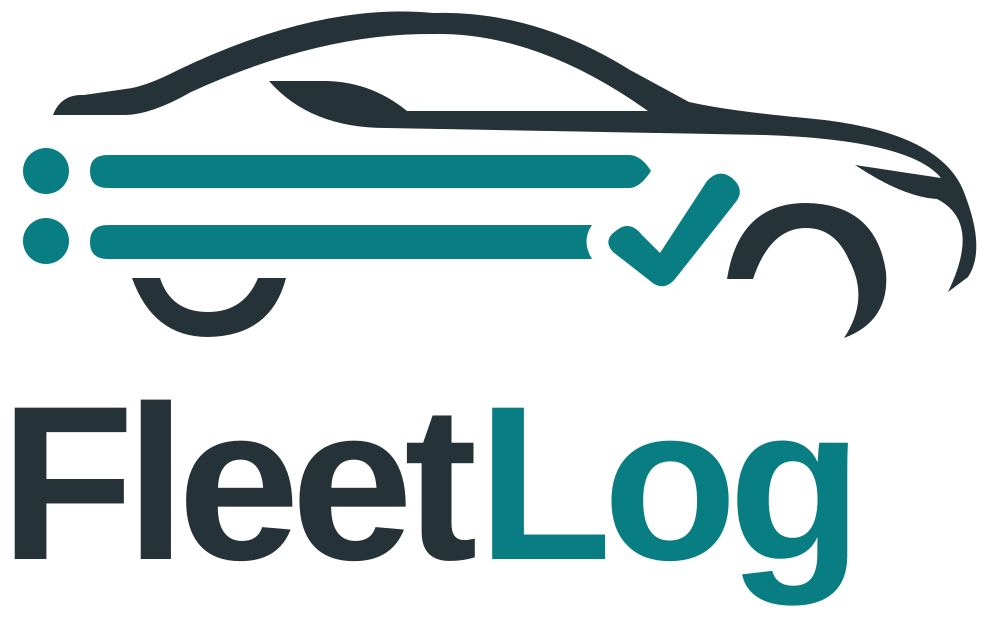
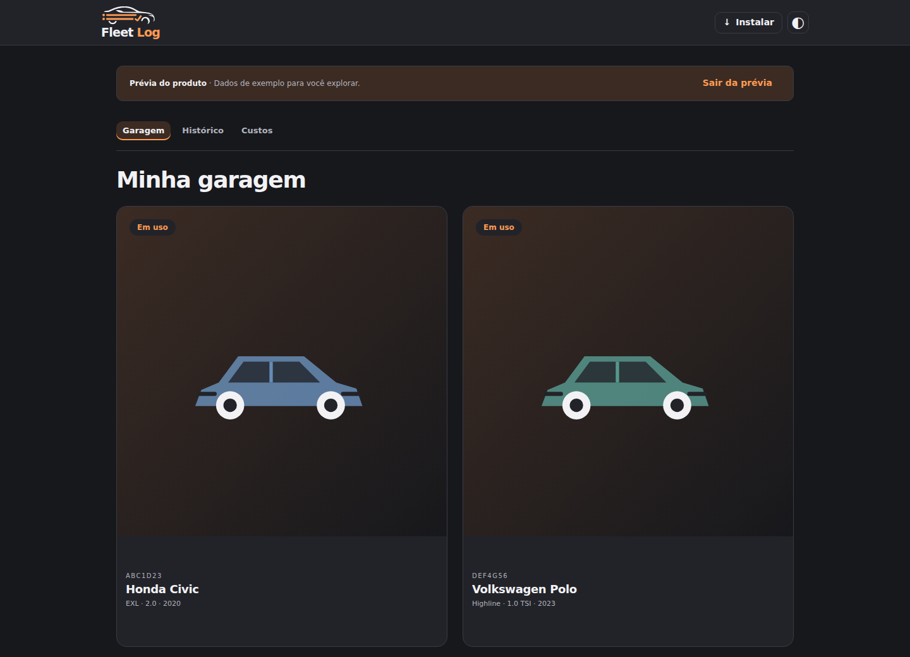
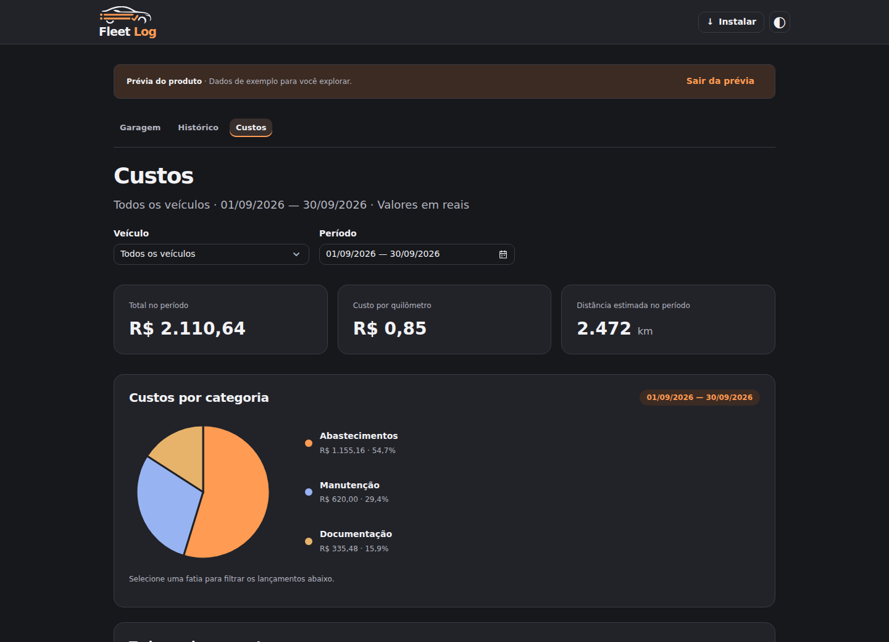
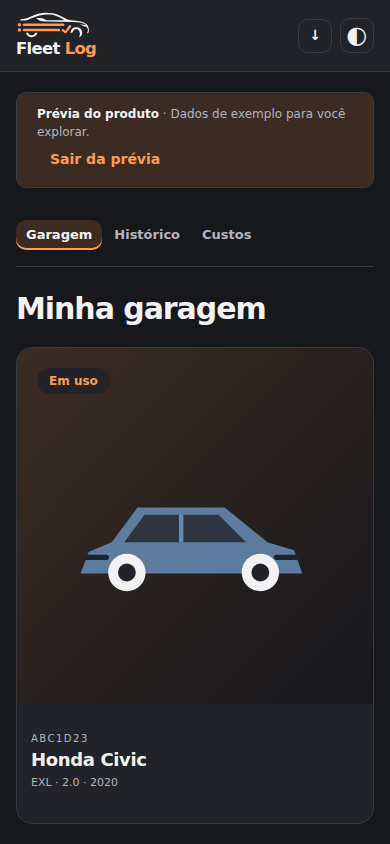

<div align="center">



# Sua garagem. Cada quilômetro, em um só lugar.

**Organize os veículos da família, acompanhe os gastos e cuide da manutenção com seus dados sob seu controle.**

[Começar com Docker](docs/self-hosting.md) · [Releases](https://github.com/gustabessa/fleetlog/releases) · [Imagem Docker](https://github.com/users/gustabessa/packages/container/package/fleetlog) · [Documentação](docs/README.md)


</div>



## Menos planilhas. Mais clareza sobre seus veículos.

Um abastecimento aqui, uma revisão ali, um comprovante perdido na conversa. O FleetLog reúne o histórico da sua garagem para você entender quanto cada veículo custa e o que precisa de atenção.

| Na rotina                           | No FleetLog                                                                                                    |
| ----------------------------------- | -------------------------------------------------------------------------------------------------------------- |
| **Toda a família na mesma garagem** | Compartilhe veículos com contas individuais e preserve a autoria dos registros.                                |
| **Saiba para onde o dinheiro vai**  | Registre abastecimentos, despesas e manutenção. Consulte histórico, filtros e gráficos de custos.              |
| **Acompanhe cada quilômetro**       | Mantenha o odômetro, confira o consumo e acompanhe o custo por quilômetro.                                     |
| **Cuide da próxima revisão**        | Organize lembretes por data e quilometragem, com histórico de manutenção e itens.                              |
| **Documentos e fotos por perto**    | Guarde notas, dados de compra e venda e imagens privadas com armazenamento S3 opcional.                        |
| **Uma experiência com a sua cara**  | Tema padrão grafite e laranja, 24 paletas e modos claro e escuro. Acesso pelo navegador e instalação como PWA. |

## Feito para a sua garagem, no computador e no celular

<table>
<tr>
<td width="70%"></td>
<td width="30%"></td>
</tr>
</table>

_Capturas reais da interface com dados fictícios da prévia integrada. Nenhum dado pessoal de produção._

## Rode onde seus dados pertencem: com você

O FleetLog é open source, com licença MIT. Você hospeda a aplicação e o banco PostgreSQL no seu próprio ambiente. Fotos são opcionais e usam um bucket S3 privado; login OIDC também é opcional.

A imagem Docker inclui frontend e backend. Não é necessário instalar Node ou Go no servidor para usar a imagem pronta.

```sh
git clone https://github.com/gustabessa/fleetlog.git
cd fleetlog
cp .env.example .env
# Configure imagem publicada, senha do banco e primeiro acesso no .env.
docker compose up -d
```

**Antes de iniciar:** siga o [guia de self-hosting](docs/self-hosting.md) para configurar as variáveis obrigatórias, escolher uma versão publicada e preparar HTTPS. O `.env.example` contém valores de exemplo que precisam ser substituídos.

As operações da garagem precisam de conexão com o servidor. A PWA guarda a interface para carregamento e oferece atualização controlada; os registros e as imagens privadas não são disponibilizados offline.

## Documentação

- [Self-hosting: Docker Compose, HTTPS e Dokploy](docs/self-hosting.md)
- [Referência técnica, configuração e desenvolvimento](docs/technical-reference.md)
- [Releases, atualização e recuperação](docs/releases.md)
- [Checklist de implantação](docs/deployment-checklist.md)
- [Plano do produto](docs/FleetLog-plan.md) e [andamento](TODO.md)

**Tecnologias:** Angular · Go · PostgreSQL · Docker · S3 · OpenID Connect

## Contribua

Encontrou um problema ou tem uma ideia? [Abra uma issue](https://github.com/gustabessa/fleetlog/issues). Para contribuir com código, consulte a [referência de desenvolvimento](docs/technical-reference.md#desenvolvimento) e abra um PR a partir de uma branch de trabalho, usando Conventional Commits no título.

[Licença MIT](LICENSE) · Criado por [Gustavo Bessa](https://github.com/gustabessa)
